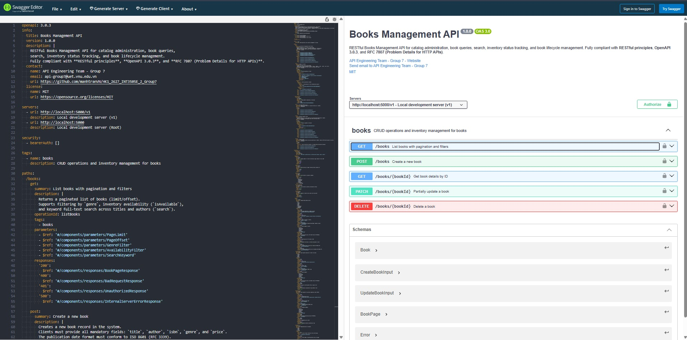

# Bài tập về nhà nhóm 7

## Minh họa đặc tả OpenAPI

Ảnh `yaml_testing` hiển thị đặc tả YAML của Books Management API trong Swagger Editor, cùng năm thao tác API và các schema dữ liệu.

## Hai quyết định thiết kế khó nhất

### 1. Dùng UUID làm định danh sách, độc lập với ISBN

**Mô tả:** Khi tạo sách, ứng dụng Flask sinh `id` bằng `uuid.uuid4()` và sử dụng ID này làm khóa trong `BOOKS_DB`. Các thao tác xem chi tiết, cập nhật và xóa xác định sách qua `book_id` trên đường dẫn. ISBN được lưu như một thuộc tính của sách và có thể cập nhật; ID do server quản lý và giữ nguyên trong suốt vòng đời bản ghi.

**Lý do:** Điểm khó là lựa chọn giữa một thuộc tính nghiệp vụ và một định danh riêng của hệ thống. Dùng UUID giúp tách danh tính bản ghi khỏi thông tin ISBN có thể được chỉnh sửa, nhờ đó đường dẫn tài nguyên và khóa tra cứu vẫn ổn định khi dữ liệu sách thay đổi. Server có thể sinh ID mà không cần quản lý bộ đếm dùng chung, với xác suất trùng rất thấp. Đánh đổi là UUID dài và khó ghi nhớ hơn; đồng thời, tính riêng biệt của ID không bảo đảm ISBN không bị nhập trùng. Vì vậy, định danh bản ghi và kiểm tra trùng dữ liệu nghiệp vụ cần được xử lý riêng; ứng dụng hiện chưa kiểm tra tính duy nhất của ISBN.

### 2. Chuẩn hóa phản hồi lỗi bằng Problem Details

**Mô tả:** API sử dụng cấu trúc Problem Details theo RFC 7807 với kiểu nội dung `application/problem+json`. Hàm `problem_details()` tạo phản hồi gồm `type`, `title`, `status`, `detail`, `instance` và `traceId`. Các endpoint và bộ xử lý lỗi dùng chung hàm này; đặc tả OpenAPI mô tả cấu trúc lỗi bằng schema `Error`.

**Lý do:** Cấu trúc lỗi thống nhất giúp client xử lý phản hồi theo cùng một quy tắc, đồng thời cung cấp thông tin để người dùng hiểu nguyên nhân thất bại. Việc tập trung tạo phản hồi vào một hàm giúp tránh sai khác giữa các endpoint và giảm công sức bảo trì. Điểm khó là phân loại đúng lỗi yêu cầu, lỗi kiểm tra dữ liệu, tài nguyên không tồn tại và lỗi nội bộ, rồi chọn mã HTTP cùng nội dung thông báo phù hợp. Quyết định này giúp tách rõ trạng thái lỗi với phần giải thích chi tiết, đồng thời hạn chế đưa thông tin nội bộ của server vào phản hồi lỗi hệ thống.
