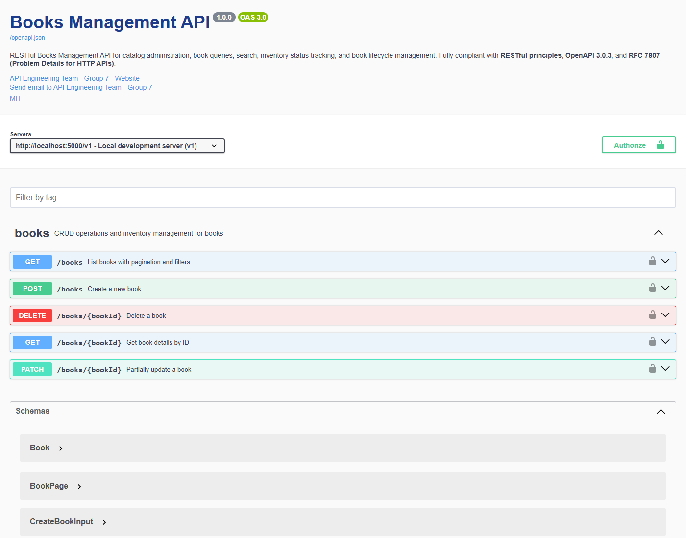
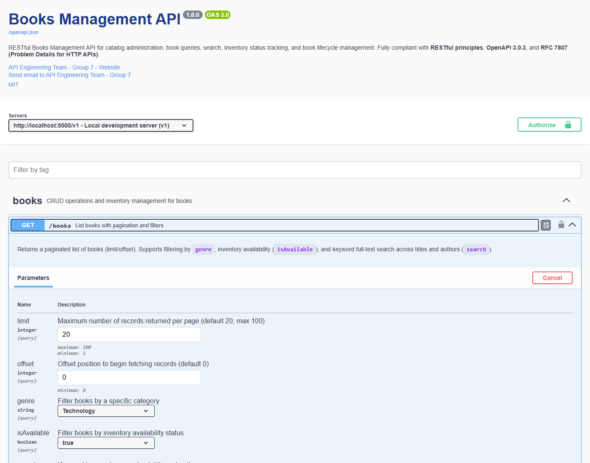
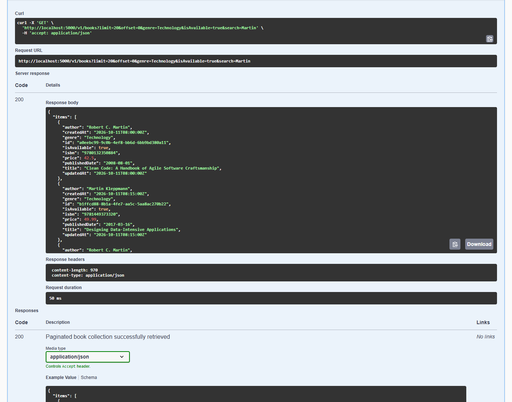
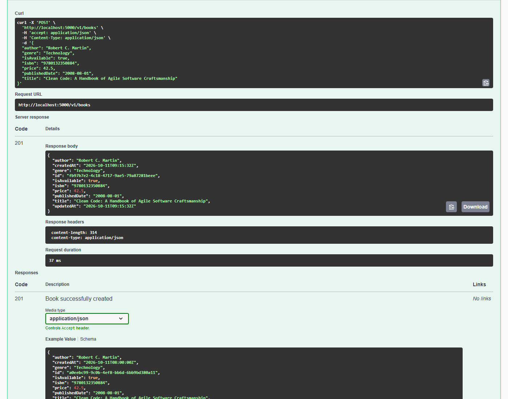
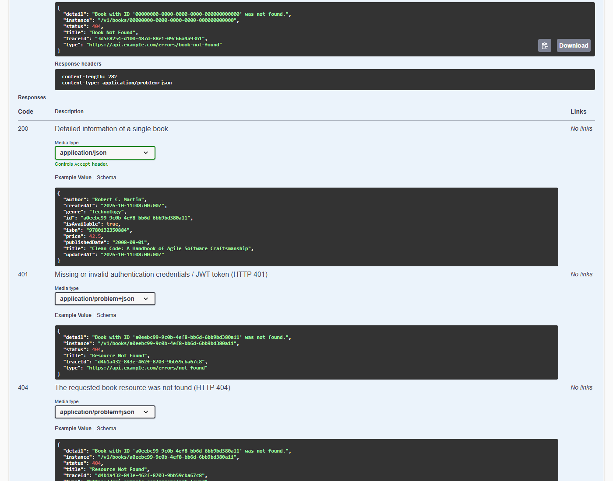

# Books Management API

> **Course**: Service-Oriented Architecture (INT3505E)  
> **Institution**: VNU University of Engineering and Technology (VNU-UET)  
> **Team**: Group 7  
> **Topic**: Week 4 – API Specification, OpenAPI 3.0.3, Swagger UI & Flask Integration

---

## 📌 Project Overview

This project implements a production-grade **Books Management REST API** adhering to all **5 homework requirements** from Lecture 4 and the best practices taught in class:
1. Standardized repository and project folder structure (`books-api/`).
2. Complete `openapi.yaml` specification conforming to **OpenAPI 3.0.3** across 5 RESTful endpoints, with component reusability via `$ref`, JWT Bearer security, and standardized error handling per **RFC 7807 (Problem Details)**.
3. Fully functional **Flask** web application exposing `/openapi.json` (machine-readable specification) and `/docs` (interactive **Swagger UI**).
4. Screenshots demonstrating active **"Try it out"** execution in Swagger UI (Curl, Request URL, HTTP 200/201/404 responses).
5. Comprehensive `README.md` documenting the system and detailing the **2 hardest design decisions**.

---

## 📂 Project Structure

```text
books-api/
├── openapi.yaml                 # OpenAPI 3.0.3 specification (Single Source of Truth)
├── app.py                       # Flask application serving API, /openapi.json, and Swagger UI at /docs
├── requirements.txt             # Python dependencies (Flask, flask-cors, pyyaml)
├── capture_live_screenshots.py  # Playwright automated browser test & screenshot script
├── README.md                    # Technical documentation & design decision analysis
├── tests/
│   └── test_api.py              # Automated test suite (unittest) validating endpoints & RFC 7807
└── screenshots/                 # Screenshots verifying Swagger UI "Try it out" execution
    ├── 01_swagger_ui_overview.png
    ├── 02_swagger_ui_try_it_out_get_ready.png
    ├── 03_swagger_ui_try_it_out_get_200_ok.png
    ├── 04_swagger_ui_try_it_out_post_201_created.png
    └── 05_swagger_ui_try_it_out_404_rfc7807.png
```

---

## 🚀 Setup & Execution Guide

### 1. Install Dependencies
Ensure Python 3.8+ is installed:
```bash
pip install -r requirements.txt
```

### 2. Start the Flask Server
```bash
python app.py
```
The server will start listening at `http://localhost:5000`:
- **Interactive Swagger UI**: [http://localhost:5000/docs](http://localhost:5000/docs)
- **OpenAPI Specification JSON**: [http://localhost:5000/openapi.json](http://localhost:5000/openapi.json)

### 3. Run Automated Tests
```bash
python -m unittest discover -s tests
```
All 7 unit tests (pagination, filtering, creation with Location header, partial update, deletion, 422 schema validation, 400 bad query, and 404 RFC 7807 problem details) will execute and pass cleanly.

---

## 📑 5 REST Endpoints Specification

Following REST resource modeling principles from the lecture:

| Method | Path | `operationId` | Description | Key Status Codes |
| :--- | :--- | :--- | :--- | :--- |
| `GET` | `/v1/books` | `listBooks` | List books with pagination (`limit`, `offset`), filtering (`genre`, `isAvailable`), and search (`search`) | `200`, `400`, `401`, `500` |
| `POST` | `/v1/books` | `createBook` | Create a new book with input validation | `201` *(Header `Location`)*, `400`, `401`, `422`, `500` |
| `GET` | `/v1/books/{bookId}` | `getBookById` | Retrieve detailed book information by UUID | `200`, `401`, `404`, `500` |
| `PATCH` | `/v1/books/{bookId}` | `patchBook` | Partially update fields of an existing book | `200`, `400`, `401`, `404`, `422`, `500` |
| `DELETE` | `/v1/books/{bookId}` | `deleteBook` | Permanently remove a book from the catalog | `204` *(No Content)*, `401`, `404`, `500` |

---

## 🎯 Compliance with Lecture Best Practices

1. **Unique & Stable `operationId`**: Explicitly named identifiers (`listBooks`, `createBook`, `getBookById`, `patchBook`, `deleteBook`) ready for SDK and client code generation.
2. **Comprehensive Schema Examples**: Every schema property contains a realistic `example` (e.g., UUID format, ISBN-13 format, date strings), allowing Swagger UI to render sample payloads immediately.
3. **Strict RFC 7807 Problem Details**: Errors never return HTTP 200 (avoiding Pitfall #1 from the slides). Standard `application/problem+json` response bodies include `type`, `title`, `status`, `detail`, `instance`, and `traceId`.
4. **DRY via `$ref`**: Schemas (`Book`, `CreateBookInput`, `UpdateBookInput`, `BookPage`, `Error`), parameters (`PageLimit`, `PageOffset`), and error responses (`NotFoundResponse`, `ValidationErrorResponse`, etc.) are declared once in `components` and referenced via `$ref`.
5. **ISO 8601 (RFC 3339) Date Format**: Dates follow `YYYY-MM-DD` (e.g. `"2008-08-01"`), preventing unstandardized date representations (Pitfall #7).
6. **Explicit Boolean Naming**: Descriptive boolean property `isAvailable` (with prefix `is_`/`is`) rather than ambiguous flags (Pitfall #8).
7. **Security Scheme Declaration**: Declared `bearerAuth` (JWT HTTP Bearer) globally in the specification, enabling the interactive **Authorize** modal in Swagger UI.

---

## 💡 Two Hardest Design Decisions (Requirement 5)

### Decision 1: Input Schema Separation for Partial Updates (`PATCH`) vs. Resource Creation (`POST`)

* **Context & Dilemma**:
  When updating resources in RESTful services, architects face a choice between `PUT` (complete replacement, idempotent) and `PATCH` (partial mutation).
  With `PUT`, clients must supply the complete entity representation even if only modifying a single property (such as toggling `isAvailable` when a book is checked out, or revising `price`). In real-world environments, requiring the whole entity risks unintentional data loss or race conditions where stale data overwrites concurrent modifications.
  However, choosing `PATCH` introduces an OpenAPI design dilemma: **How should schemas be modeled so creation remains strictly validated while updates remain flexible?** Reusing a single `Book` schema fails because properties required during creation (`title`, `author`, `isbn`, `genre`, `price`) would cause a valid partial update `{ "price": 39.99 }` to fail schema validation with HTTP 422.

* **Design Solution**:
  We decoupled the input models into two dedicated component schemas:
  1. `CreateBookInput`: Enforces `required: [title, author, isbn, genre, price]` and validates strict constraints (e.g., ISBN regex `^[0-9]{13}$`, non-empty strings, positive price).
  2. `UpdateBookInput`: Marks all properties as optional. Clients can supply any subset of attributes. However, when an attribute is provided, it must still satisfy its domain validation rules.
  3. In the Flask service layer, `patch_book()` inspects which keys are present in the JSON body, mutates only those fields on the existing record, preserves unmentioned fields, and automatically updates the `updatedAt` ISO 8601 UTC timestamp.

* **Outcome**:
  This architecture provides maximum client flexibility, avoids unnecessary payload overhead, and maintains rigorous contract validation without compromising API integrity.

---

### Decision 2: RFC 7807 (Problem Details) Error Architecture & Component Reusability via `$ref`

* **Context & Dilemma**:
  Inconsistent error reporting is one of the most frequent defects in API development (highlighted in Slide 15 and Common Pitfalls #1 & #3). Services often return ad-hoc error bodies (such as `{ "error": "msg" }` on one route versus `{ "message": "...", "status": 404 }` on another) or mistakenly respond with HTTP 200 accompanied by an error string. This makes client-side error handling fragile and prevents automatic SDK error parsing.
  Furthermore, duplicating error response definitions across all 5 endpoints in `openapi.yaml` bloats the specification and violates the DRY (Don't Repeat Yourself) principle.

* **Design Solution**:
  We adopted the IETF standard **RFC 7807 (Problem Details for HTTP APIs)** using `application/problem+json`:
  1. Centrally defined `components.schemas.Error` with 6 standard attributes:
     - `type`: URI identifying the error category (e.g., `https://api.example.com/errors/book-not-found`)
     - `title`: Short human-readable summary of the error
     - `status`: Integer matching the HTTP status code (400, 401, 404, 422, 500)
     - `detail`: Context-specific description of the exact failure cause
     - `instance`: URI path of the resource where the error occurred
     - `traceId`: Unique UUID v4 generated per request for distributed tracing
  2. Reusable response objects declared in `components.responses`:
     - `BadRequestResponse` (400)
     - `UnauthorizedResponse` (401)
     - `NotFoundResponse` (404)
     - `ValidationErrorResponse` (422)
     - `InternalServerErrorResponse` (500)
     Each references `components.schemas.Error` via `$ref`.
  3. In Flask, implemented the helper `problem_details(status, title, detail)` and registered global `@app.errorhandler` handlers to ensure all unhandled exceptions adhere strictly to RFC 7807.

* **Outcome**:
  This approach establishes a single source of truth across the entire system. Swagger UI accurately documents error schemas, and consuming clients can rely on consistent machine-readable error responses.

---

## 📷 Screenshots Verifying Swagger UI "Try It Out" Execution (Requirement 4)

All screenshots were captured live via Playwright against the running application:

### 1. Swagger UI Overview at `/docs`
Displays the Books API metadata, servers, tags, endpoints, and the **Authorize** button:


---

### 2. Expanded `GET /v1/books` in "Try it out" Mode
Parameter input fields (`limit`, `offset`, `genre`, `isAvailable`, `search`) ready for interaction:


---

### 3. Execution of `GET /v1/books` (HTTP 200 OK)
Generated Curl command, Request URL, Server Response Code **200 OK**, duration, and JSON body:


---

### 4. Execution of `POST /v1/books` (HTTP 201 Created)
Payload sent, response status **201 Created**, `Location` response header, and returned book entity:


---

### 5. Error Testing on `GET /v1/books/{bookId}` (HTTP 404 RFC 7807)
Querying a non-existent UUID returns **404 Not Found** with `application/problem+json`:


---

## 👥 Authors
- **Team**: Group 7
- **Class**: INT3505E_2 (Fall Semester 2026-2027)
- **Institution**: Department of Software Engineering & Information Systems, VNU-UET
