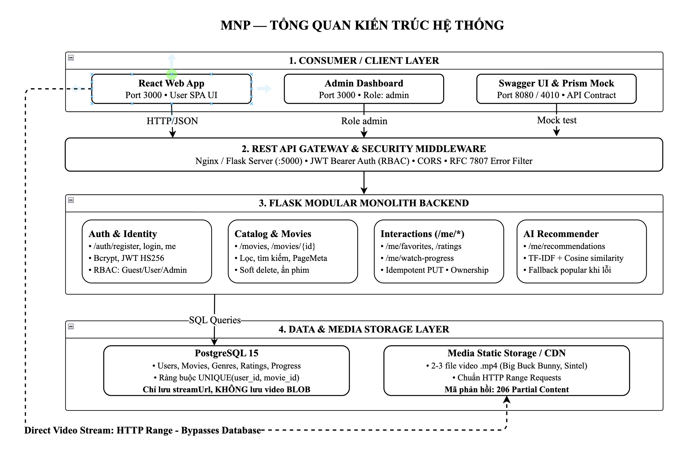
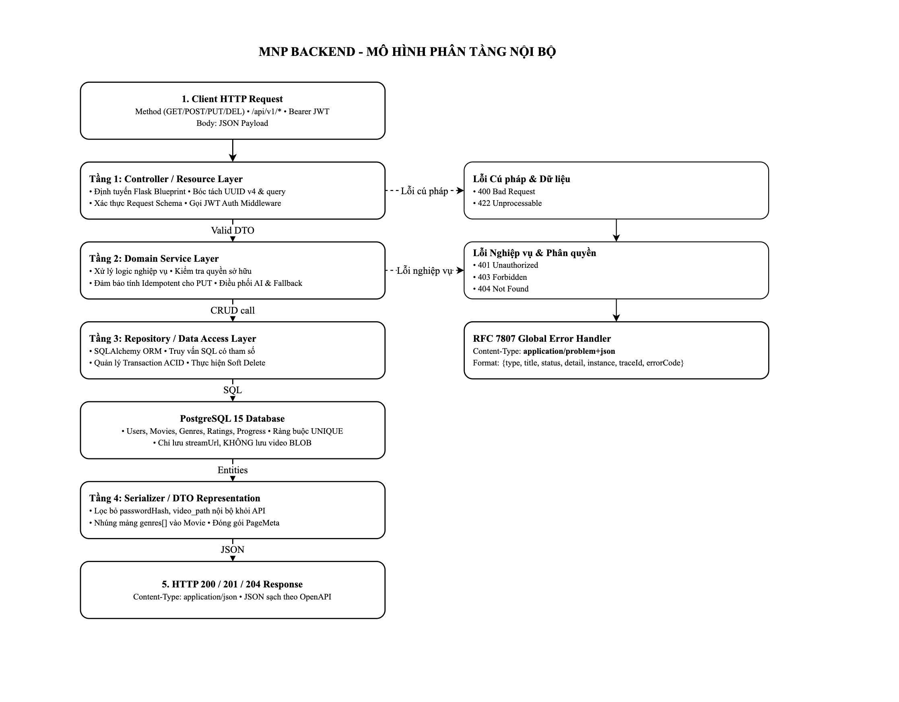
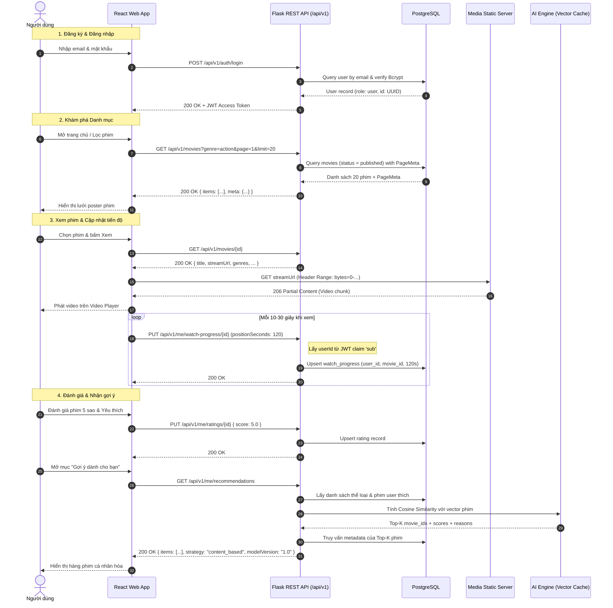

# Kiến trúc Hệ thống MNP - Movie Navigator Promax

> **Tài liệu đặc tả kiến trúc kỹ thuật & thiết kế dịch vụ
> Dự án: MNP - Movie Navigator Promax**

---

## 1. Tổng quan Kiến trúc

Hệ thống Movie Navigator Proamx được thiết kế theo kiến trúc **Modular Monolith** kết hợp với **API-First Design.** Kiến trúc này tách biệt triệt để giữa Client, Backend Service và tầng Lưu trữ Dữ liệu.

---

## 2. Phân tầng Nội bộ Backend

> **Sơ đồ chi tiết:** Xem file Draw.io [backend-layering.drawio](file:///Users/tuanphong/Downloads/KTHDV/HK1_2627_INT3505E_2_Group7/docs/design/backend-layering.drawio) hoặc file ảnh Vector [backend-layering.svg](file:///Users/tuanphong/Downloads/KTHDV/HK1_2627_INT3505E_2_Group7/docs/design/backend-layering.svg).

Bên trong mỗi module của Flask Backend, kiến trúc tuân thủ nghiêm ngặt mô hình phân tách 3 lớp **Resource/Controller $\rightarrow$ Service $\rightarrow$ Repository/Data Access** cùng tầng **Schema/Serialization** để ngăn chặn rò rỉ cấu trúc cơ sở dữ liệu ra ngoài API công khai:

---

## 3. Ranh giới và Trách nhiệm của các Module

| Module                      | Phạm vi Endpoints                                                      | Trách nhiệm chính                                                                                                                                      | Ràng buộc nghiệp vụ quan trọng                                                                                                                                                                   |
| --------------------------- | ----------------------------------------------------------------------- | --------------------------------------------------------------------------------------------------------------------------------------------------------- | ----------------------------------------------------------------------------------------------------------------------------------------------------------------------------------------------------- |
| **Auth & Identity**   | `/auth/register/auth/login``/auth/me`                                 | Quản lý tài khoản người dùng, mã hóa mật khẩu Bcrypt, cấp phát và xác thực JWT Bearer Token.                                              | • Không trả `passwordHash` ra ngoài.• Quản lý 3 vai trò: `Guest`, `user`, `admin`.                                                                                                    |
| **Catalog & Admin**   | `/movies/movies/{id}``/genres`                                        | Tra cứu danh mục phim, tìm kiếm từ khóa `q`, lọc theo `genre`, `year`, phân trang `PageMeta`, quản trị thêm/sửa/ẩn phim.             | • Định danh bằng UUID v4.• Phim `status: hidden` trả về `404 Not Found` với Guest/User.• Xóa phim là Soft Delete (`204 No Content`).                                                 |
| **User Interactions** | `/me/favorites/*/me/ratings/*``/me/watch-progress/*/me/preferences/*` | Quản lý tương tác cá nhân của người dùng đã đăng nhập: danh sách yêu thích, đánh giá sao (0.5 - 5.0), vị trí video đang xem dở. | • **Idempotency:** Gọi lặp `PUT` cùng tài nguyên không làm tăng số lượng bản ghi.• Suy ra danh tính `userId` trực tiếp từ claim `sub` trong JWT, ngăn chặn lỗi IDOR. |
| **AI Recommendation** | `/me/recommendations/movies/{id}/similar`                             | Tính toán danh sách phim gợi ý cá nhân hóa dựa trên nội dung và phim tương tự.                                                            | • Chạy suy luận từ ma trận TF-IDF & vector thể loại/mô tả.• Khi người dùng mới hoặc AI quá tải, fallback trả về top phim phổ biến kèm `strategy: "fallback_popular"`.         |

---

## 4. Kiến trúc Lưu trữ Dữ liệu và Video Media

### 4.1. Cơ sở dữ liệu quan hệ

* **Khóa chính UUID v4:** Tất cả các bảng nghiệp vụ (`users`, `movies`, `genres`) sử dụng UUID v4 ngẫu nhiên làm khóa chính để che giấu quy mô dữ liệu và tránh tấn công đoán ID tuần tự.
* **Toàn vẹn quan hệ:**
  * Bảng liên kết nhiều-nhiều `movie_genres` có ràng buộc khóa ngoại `CASCADE` và khóa chính phức hợp `(movie_id, genre_id)`.
  * Các bảng tương tác `favorites`, `ratings`, `watch_progress` có ràng buộc `UNIQUE(user_id, movie_id)`.
* **Chỉ mục:** Đánh chỉ mục B-Tree trên `(status, release_year)`, `(title)` và các khóa ngoại để tối ưu hóa truy vấn lọc danh mục phim.

### 4.2. Lưu trữ và Phát video Media

* **Nguyên tắc thiết kế:** Không lưu trữ dữ liệu nhị phân của video vào PostgreSQL.
* **Cơ chế lưu trữ:** Các file video (.mp4) được đặt trong thư mục máy chủ tĩnh (`static/videos/`) hoặc Object Storage/CDN.
* **Cơ chế phát sóng:** Hỗ trợ **HTTP Byte-Range Requests**:
  * Khi client gửi Header: `Range: bytes=0-1048575`
  * Server phản hồi mã `206 Partial Content` kèm `Content-Range: bytes 0-1048575/52428800`.
  * Nhờ đó, trình phát video trên React có thể tua tức thì và phát mượt mà mà không phải tải toàn bộ file về bộ nhớ.
* **Phạm vi MVP:** Giới hạn 2–3 video mã nguồn mở. Chỉ những phim có video thật mới kích hoạt nút phát trên giao diện người dùng.

---

## 5. Luồng Dữ liệu Người dùng End-to-End

Sơ đồ tuần tự minh họa toàn bộ luồng nghiệp vụ từ góc nhìn Client Consumer:

---

## 6. Sẵn sàng cho Hướng Phát triển Microservices

Mặc dù triển khai dưới dạng **Modular Monolith** trong giai đoạn đồ án môn học, hệ thống đã được cô lập ranh giới dữ liệu để sẵn sàng tách thành 2 Microservices độc lập trong tương lai nếu có yêu cầu:

1. **Core API Service:** Quản lý User, Catalog, Interactions và phát hành JWT Token.
2. **Recommendation Microservice:** Lưu trữ mô hình AI và ma trận vector riêng, giao tiếp với Core API thông qua HTTP REST nội bộ hoặc Message Queue với cơ chế đồng bộ snapshot dữ liệu và Circuit Breaker / Fallback tự động.
